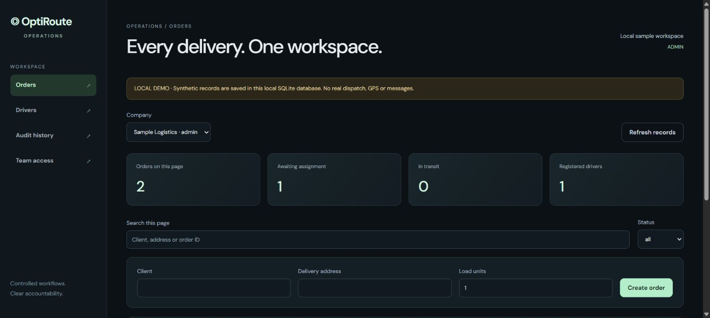
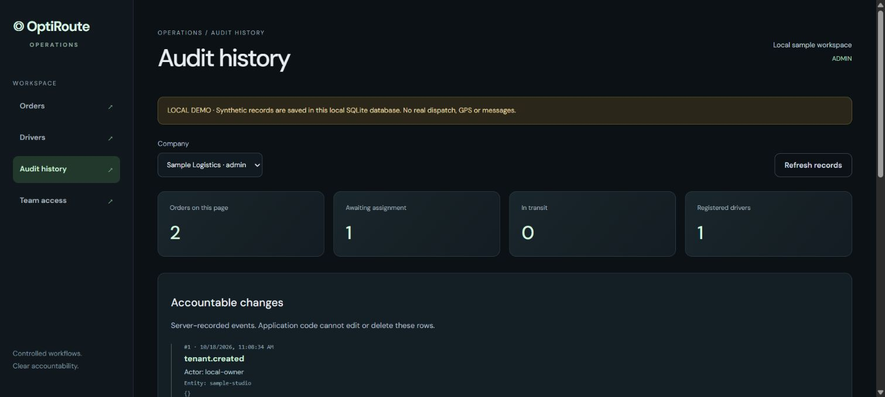

# OptiRoute Operations

A company-scoped delivery-operations foundation: controlled assignments, accountable changes and an inspectable engineering design.

**Status:** working local implementation with automated tests and browser proof. This is an enterprise foundation, not a claim of production certification, deployed SSO, live GPS or a commercially operating fleet.



## What makes this more than a dashboard

| Business problem                                  | Implemented control                                      | Inspectable proof                                    |
| ------------------------------------------------- | -------------------------------------------------------- | ---------------------------------------------------- |
| Companies must not see each other’s records       | Server-side company membership and scoped queries        | Cross-company API/store tests                        |
| Read-only users must not dispatch                 | Admin / dispatcher / viewer checks on every operation    | Forged-role and privilege-escalation denial tests    |
| Two operators must not overwrite each other       | Required record version; stale changes return 409        | Conflict and lifecycle tests                         |
| Retried requests must not create duplicate orders | Transactional create-order idempotency receipts          | Same-key replay and changed-payload tests            |
| Drivers must not receive excess load              | Capacity checks and assignment in one transaction        | Over-capacity rollback and capacity-release tests    |
| Changes need accountability                       | Server-recorded audit, application update/delete blocked | Audit triggers, actor/state history and UI proof     |
| Access must be revocable                          | Admin-only membership registry and revocation            | Immediate denial after revoke; last-admin protection |
| Data must survive a restart                       | SQLite WAL with consistent backup helper                 | Reopen and backup/restore tests                      |

The operations service is **separate** from the original preview demo. It does not inherit the legacy demo server’s unsigned endpoints or browser-direct Firestore mutation model.

## Try the working local version

Use Node 24 LTS. SQLite remains experimental in the tested Node 24.11 runtime.

```sh
npm ci
cp firebase-applet-config.example.json firebase-applet-config.json
npm run enterprise:build
npm run enterprise:demo
```

Windows PowerShell: replace `cp` with `Copy-Item` if desired. Open the printed loopback URL, normally `http://127.0.0.1:4185`.

This explicitly labelled local mode uses synthetic records and persists to `runtime/demo.sqlite`. It does not require a real login, dispatch deliveries or send messages. Production mode rejects sample identity mode and requires real server-side Firebase configuration. Do not deploy local-demo mode.

## Explore the engineering

- [Architecture, trust boundaries, state machine and tradeoffs](docs/ARCHITECTURE.md)
- [API contracts, role matrix and failure responses](docs/API.md)
- [Deployment prerequisites, backup and recovery runbook](docs/OPERATIONS.md)
- [Executed verification and limits](docs/VERIFICATION.md)
- [REA compiled-artifact inspection receipt](docs/REA-RECEIPT.json)

```sh
npm run test:enterprise
npm run lint
npm run enterprise:build
npm audit --audit-level=high
```

GitHub Actions runs the foundation checks on main, the feature branch and pull requests. Consult the actual run status; a workflow definition alone is not proof of a successful run.

## See the workflow

A real local browser walkthrough created a synthetic order, assigned a driver, progressed it through `assigned → in_transit → delivered`, inspected the audit trail and reloaded the persisted record. Quantities, timestamps and counts in screenshots come from that test database.



[390px responsive preview](docs/operations-mobile.png). The table scrolls within its container; this is a bounded desktop/mobile preview check, not a complete real-device accessibility certification.

## Production boundary

Before serving real customers: configure and test actual Firebase identity/revocation, managed HTTPS and durable storage, encrypted/off-host backups, restore acceptance, observability, security/load testing and company-specific operational rules. Current storage targets a single application instance; PostgreSQL migration is needed before a multi-replica write workload. SSO/SAML, real route optimization, telematics and contractual SLAs are not implemented.

No private keys, environment values, hosted Firebase config, runtime databases, backups or generated build artifacts are committed. Private AI inference is disabled in the public frontend configuration; there is no paid-model fallback.

## Original portfolio demo

[Existing live fleet demo](https://ais-pre-tt57r3zgetshqrwfrdru54-357091713250.asia-southeast1.run.app/) · [Portfolio](https://deepshekhar-builds.deepshekhar.chatgpt.site) · [Legacy setup and boundaries](docs/LEGACY-DEMO.md)

That hosted preview remains the earlier illustrative fleet demo. The new operations foundation has **not** replaced it or been deployed as a production service.

Original source notices are retained. No additional license grant is asserted here.
