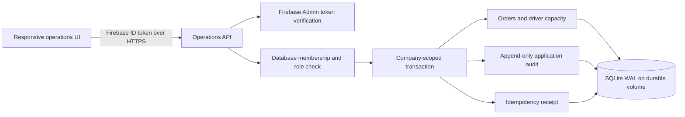
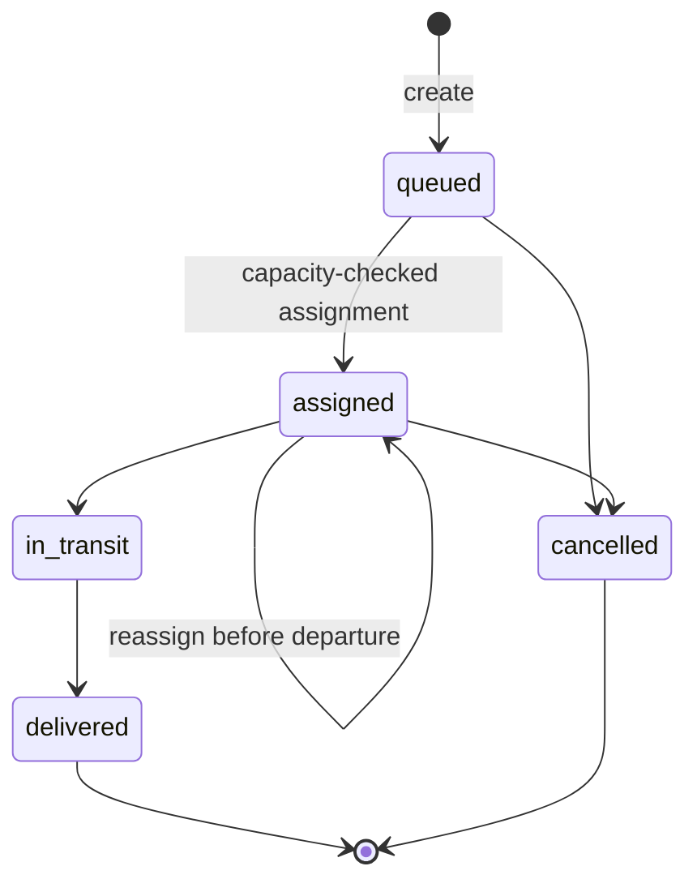

# OptiRoute Operations — architecture and decisions

Status: implemented enterprise **foundation**, not a production certification. This service and its UI are separate from the original Firestore/Express preview demo. The legacy server is not the enterprise API and must not be used as a security boundary for company data.

## Request path and trust boundary

The browser never decides its own role, sends an authoritative actor UID or writes enterprise records directly to Firestore. The verified token supplies identity; server-side membership supplies role. Every store operation scopes queries by company. A user who belongs to one company does not gain access to another company's IDs.

`verifyIdToken(token, true)` checks token validity and revocation using the Admin SDK. Service credentials remain server-side via application default credentials. Production mode has no unsigned-token or emulator fallback. Local sample mode is explicit, binds to loopback and is rejected with `NODE_ENV=production`. Its records are synthetic and use `runtime/demo.sqlite`, separate from production's default database.

## Permissions

| Capability                         | Viewer | Dispatcher | Admin |
| ---------------------------------- | ------ | ---------- | ----- |
| Read company orders and drivers    | Yes    | Yes        | Yes   |
| Create, assign and progress orders | No     | Yes        | Yes   |
| Register drivers                   | No     | No         | Yes   |
| Manage membership                  | No     | No         | Yes   |
| Read audit history                 | No     | No         | Yes   |

Membership changes take effect on the next API request. The last administrator cannot be demoted. Membership provisioning is a trusted operator command or an already-authorized administrator action; an authenticated user cannot self-enroll into a company.

## State model

The API requires the current integer `version` for every assignment or transition. A stale version returns 409 instead of overwriting a newer action. Terminal orders cannot be reopened through these endpoints. No destructive order delete exists.

## Atomicity and capacity

An assignment executes inside `BEGIN IMMEDIATE`. It reads the driver in the same company and sums the volume of that driver's assigned/in-transit orders, excluding the edited order. If the new load exceeds capacity, it returns 409. Otherwise the assignment, version increment and audit record commit together. Delivered/cancelled orders no longer consume capacity. Validation rejects nonfinite, nonpositive and oversized quantities.

Capacity and volume use the same abstract load unit. This is not a certified weight/volume model, driving-hours engine or geographic route optimizer. Actual road routing, live GPS, time windows and vehicle constraints require separate implementation and validation.

## Retry behavior

Create-order requests require an idempotency key. The service stores its fingerprint and original response within the order transaction, scoped to company and actor. Same key/same normalized request returns the original order; a changed request with that key returns 409. Failed transactions produce no order or misleading audit entry. The UI preserves the key across a failed request until the form changes or a successful response arrives. Reloading the browser currently loses its unsent form/key; durable client-side pending-request reconciliation is a remaining rollout item.

## Why SQLite in this milestone?

- Real persistence and transactions, reproducible local operation, no paid hosted dependency needed for development.
- WAL plus bounded transactions support this single-instance foundation. A consistent native SQLite backup helper is included.
- This is **not** a horizontal-scale architecture. Before multiple app replicas or high sustained write volume, migrate the repository interface to PostgreSQL and test transaction isolation/load on the target platform. A SQLite file on ephemeral Cloud Run storage is not an acceptable durable production database.

## Auditing and observability

Events record actor, company, action, entity, details and server timestamp. SQLite triggers reject ordinary update/delete of audit rows. A database administrator can still alter the database or remove triggers; this is not cryptographic tamper evidence or compliance certification. Responses carry a request reference; errors avoid token, stack and business-record disclosure. Audit pages are cursor-based, order pages are bounded offset pages. Metrics in the UI explicitly describe the current page rather than inventing global totals.

## Boundaries still requiring work

Managed production hosting/TLS and durable storage; real Firebase/Admin credentials and revocation integration acceptance; SSO/SAML and MFA policy; granular dispatch permissions; independent security review; encrypted backup/key management; load/soak and disaster-recovery exercises; distributed rate limiting; operational alerting; real routing and telematics; browser reload-safe pending requests. UI role hints can become stale until refresh, while server permissions are checked per request. The application does not send carrier notifications or move real vehicles.

The strongest proof is the executable test suite and recorded UI path, not the word “enterprise”.
