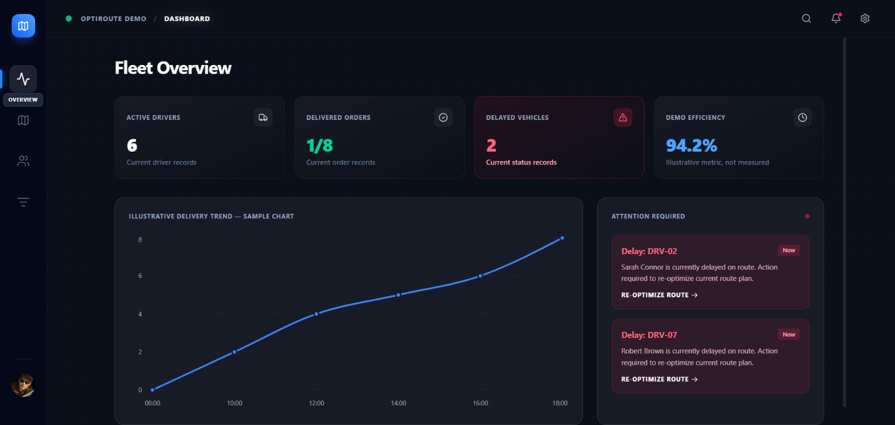

# OptiRoute

A fleet-operations dashboard and illustrative assignment planner.

[Live demo](https://ais-pre-tt57r3zgetshqrwfrdru54-357091713250.asia-southeast1.run.app/) · [Portfolio](https://deepshekhar-builds.deepshekhar.chatgpt.site) · [GitHub](https://github.com/deepshekhardas)



## What it demonstrates

Fleet overview; map-based planner; driver and order screens; deterministic capacity-based assignment preview without database writes.

## Run locally

Use Node.js 22 or newer and npm.

```sh
npm ci
```

Copy `firebase-applet-config.example.json` to `firebase-applet-config.json` and fill in your **own** Firebase web-app configuration. Enable Google authentication, configure authorized domains and deploy reviewed Firestore rules to your own project. This repository intentionally excludes the author's hosted-project configuration and all environment files with values. Firebase web configuration is not an admin credential; access still depends on your authentication and security rules. Do not reuse the author's hosted database.

```sh
npm run dev
npm run lint
npm run build
```

Private AI/payment integrations are disabled by default. The public Vite configuration deliberately does not inline a private Gemini key into browser code. Any future private-key integration must run server-side and requires separate testing.

## Verification and boundaries

TypeScript and Vite builds passed in the repair workspace on 18 October 2026. These results used the owner's local development configuration; a fresh installation with your own Firebase project requires setup. Shared demo UI was checked after source save. The checked-in screenshot is an actual demo capture, not a client deployment or fabricated outcome.

Assignment suggestions are a demo heuristic, not optimal VRP routing or real dispatch. Vehicle movement and efficiency metrics are illustrative. A minor legacy loading name remains.

These are independent portfolio demos, not claims of client deployment, clinical certification or production scale. The linked Cloud Run preview hosting has no permanence or uptime guarantee. Mobile checks were bounded: CollabSphere/TicketFlow preview layouts were inspected; full signed-in Aura/OptiRoute mobile flows remain unverified.

## Source

React, TypeScript, Vite and Tailwind CSS. Original source headers/notices are retained. No new license grant is asserted by this publication. Generated build artifacts, dependencies, real credentials, hosted Firebase configuration and exported runtime data are excluded.
